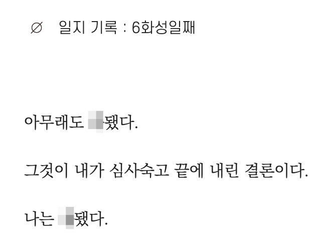
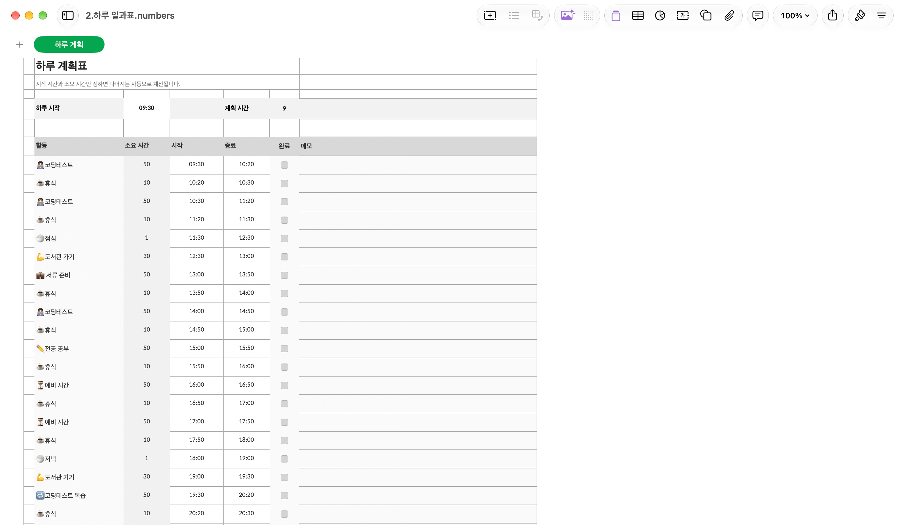
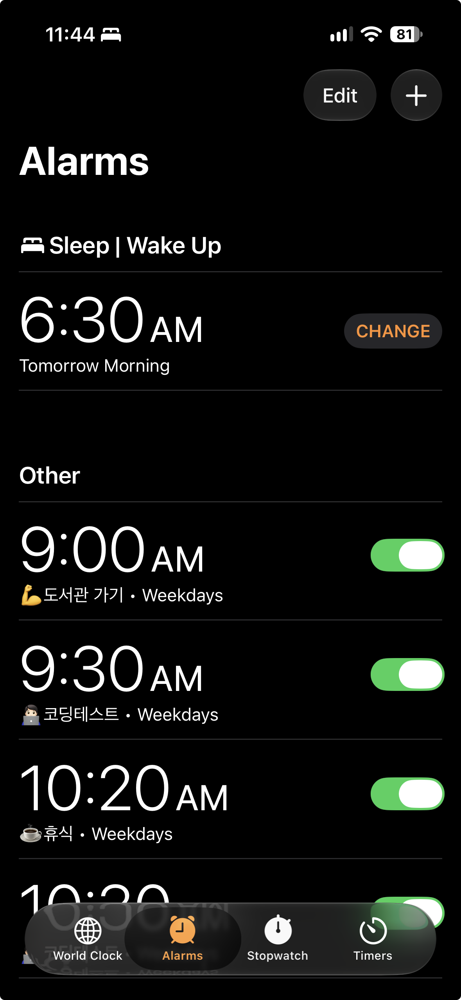
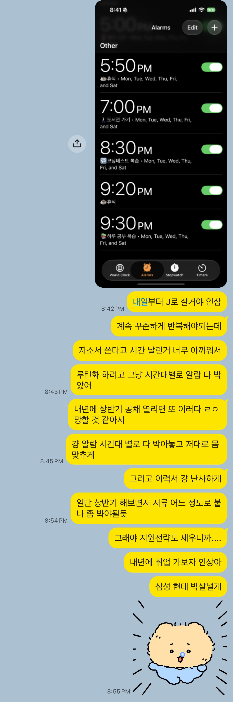
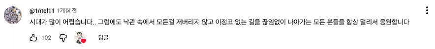

본격적으로 취업 준비를 하기 시작한 지 이제 한 달이 조금 넘었다.

취업 준비하면서 느끼는 생각은..

{:width="50%"}

<br>

이건 진짜다. 요즘 취업 어렵다고들 하지만 이걸 직접 겪는 건 또 다른 차원의 문제다.

나도 익히 들어서 알고는 있었지만 막상 내가 취준생이 되보니 정말 막막하다..

<br>

일단 가장 불안한 건 내 스펙으로 어느 정도까지 가능한가를 모른다는게 불안하다.

물론 떨어질 것 같아서 지원을 안 할거냐? 하면 그건 아니기 때문에 그냥 열심히 준비하는 수 밖에 없지만, 다 떨어져서 아무것도 못하고 내년 상반기를 그냥 보내게 될까 두렵다..

<br>

지금까지 총 네 개의 회사에 지원했는데 자소서와 포트폴리오를 준비하는데 시간을 많이 뺏겼다.

네 개 지원하는데도 이 정도인데, 괜히 마구잡이로 지원했다가 자소서 퀄리티도 떨어지고 그러다 괜히 붙을 회사도 떨어지는 거 아닌가? 싶어서 내년 상반기 전략이 매우 매우 고민됐다..

타겟 기업을 정해서 집중 공략해야 할지, 아니면 그냥 이력서 난사를 해야할지 고민해봤는데 공채 시즌 전에 미리 미리 자소서 + 포트폴리오 좀 준비해놓은 다음, 정말 가고 싶은 기업들은 거기다가 +α 해서 신경 써서 지원하고 나머지는 복붙 + 약간 수정해서 지원하기로 결정했다.

*일단 내 스펙이 취업 시장에서 어느정도인지 감이 안오는 상황이라 소신지원 했다가 다 떨어지면 그대로 상반기를 날림 + 어떤게 문제인지 분석하기 어려워서 하반기도 그대로 날릴 가능성이 크다고 판단했다.* [참고한 글](https://blog.naver.com/PostView.naver?blogId=darddong&logNo=220586673130&parentCategoryNo=&categoryNo=43&viewDate=&isShowPopularPosts=false&from=postView)(요새 취업 관련 유튜브나 블로그 글, 책 같은거 많이 찾아보는데 이 분이 제일 나은 듯 싶다)

<br>

또 이번에 자소서랑 포트폴리오 준비하면서 느낀게 하루종일 붙들고 있는데 진도는 제자리라 시간 낭비가 너무 심했다. (주말부터 오늘까지 붙들고 있었다...)

내 루틴이 깨져버린게 너무 싫기도 하고 뭔가 지금 당장 이걸 교정하지 않으면 내년 상반기에도 또 자소서 쓴다고 이 짓을 반복 -> 준비할 게 산더민데 제대로 못함 -> 취업 못함이 될 것 같아서 어떻게 할지 고민하다가 알람을 일정 시간대에 맞춰서 설정했다.



<br>

{:width="50%"}

<center><i>J들의 마음을 조금은 알 것 같다.</i></center>

정말 이렇게까지 강박적으로 하고 싶지 않았지만.. 나는 정말 간절하다...

물론 간절하지 않은 취준생은 없겠지만..

<br>

지난 몇 주간 마음이 아주 뒤숭숭 했다..

```
🫨 불안: 아니 열심히 준비했는데 다 떨어지면 어떡하지?

🥺 우울: 취준 n년 차인 내 모습 상상

🔥 용기: 아니야 긍정적으로 생각해야지 할 수 있다

🫠 두려움: 근데 나보다 스펙 좋은 사람들도 다 서탈한다던데...

🔁 다시 불안: 아니 근데 진짜 다 떨어지면 어떡하지?
```

걱정한다고 달라질게 하나도 없단 걸 알지만 그래도 불안한 걸 🥲

<br>

아무튼 계속 저런 상태였지만 다시 마음을 다 잡았다.

{:width="50%"}

<br>

네이버 블로그도 아니고 누가 이 글을 볼까 싶지만 이렇게 글로 쓰면 실체 없는 불안이 좀 사라지기도 하고.. 또 나중에 취업하고 보면 좋은 추억이 되지 않을까해서 한 달에 한 번 정도 꾸준히 글을 써보려고 한다.

이상 불안이의 한 달 취준 후기였습니다..


<br>

<details markdown="1">
<summary>🍪</summary>



취업 관련 유튜브 보다가 발견한 인류애 넘치는 댓글 *너무 감동적이다..*

다들 응원합니다 파이팅
</details>